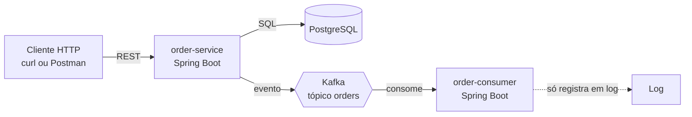
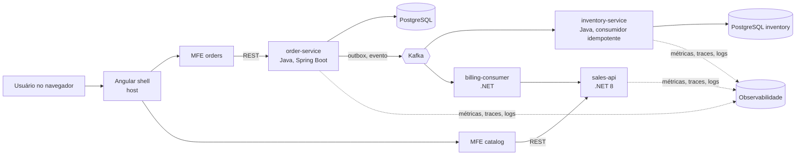
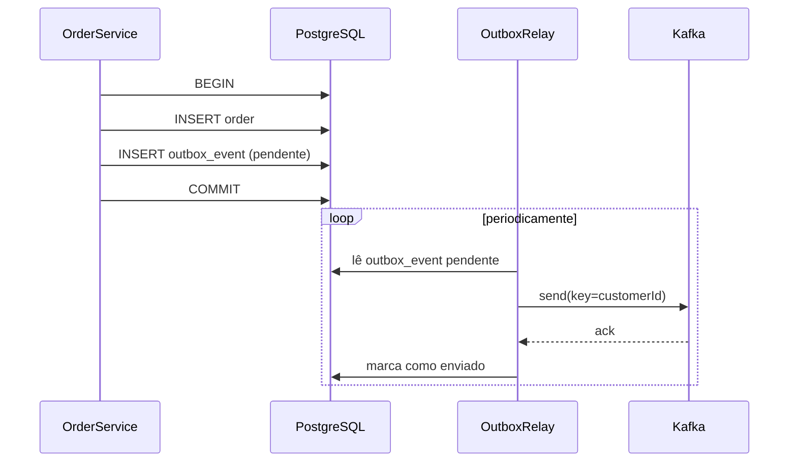
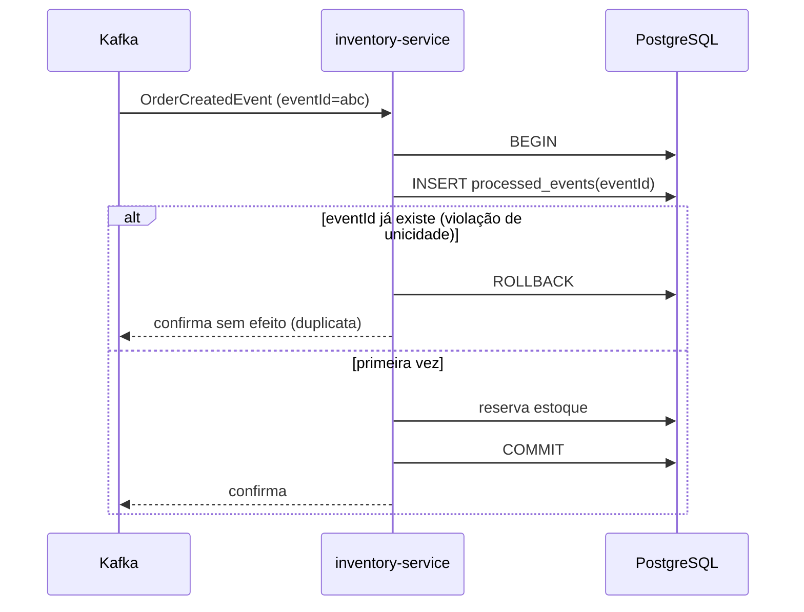
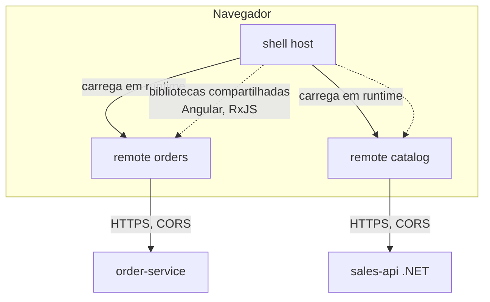

# Arquitetura: de onde estamos para onde vamos

Documento de trabalho da evolução do projeto: do par `order-service` e `order-consumer` para uma plataforma de vendas ponta a ponta, com front-end em micro front-ends Angular, mensageria, serviço .NET, observabilidade e deploy em plano gratuito. Os diagramas são Mermaid (o GitHub os renderiza).

Regra do projeto: só entra no README, no currículo e no LinkedIn o que estiver rodando no repositório.

## 1. Visão macro (contexto)

### Hoje

O fluxo de hoje, em uma frase: um pedido entra por REST, é gravado no PostgreSQL e um evento é publicado no Kafka; o consumidor lê o evento e apenas o registra em log.

### Alvo

## 2. Visão média (contêineres)

### Hoje (o que existe no repositório)

| Contêiner | Tecnologia | Papel |
|---|---|---|
| `order-service` | Java 17, Spring Boot 4, Web, Data JPA, Spring Kafka | API REST de pedidos (criar, atualizar, listar paginado, cancelar) e publicação de eventos |
| `order-consumer` | Java 17, Spring Boot 4, Spring Kafka | Consome `orders` com um `@KafkaHandler` por tipo de evento; erro de desserialização é logado e pulado |
| PostgreSQL | 1 instância | Dados do `order-service` |
| Kafka | KRaft, 1 broker, tópico `orders` com 3 partições | Eventos `created`, `updated`, `cancelled`, chave = `customerId` |

Decisões já registradas: [docs/adr](adr/) (tópico com dono, valor monetário com duas casas, concorrência otimista, paginação, tipo do evento no header, ciclo de vida do pedido).

### Alvo (proposta)

| Contêiner | Tecnologia | Papel novo |
|---|---|---|
| `web-shell` | Angular | Host dos micro front-ends: layout, roteamento, carregamento dos remotes |
| `web-orders` | Angular | Remote: lista e cria pedidos |
| `web-catalog` | Angular | Remote: produtos, consome a `sales-api` (.NET) |
| `order-service` | Java, Spring Boot | Passa a gravar o pedido e o evento na mesma transação (outbox) |
| `inventory-service` | Java, Spring Boot | Antigo `order-consumer`: consumidor idempotente que reserva estoque |
| `billing-consumer` | .NET 8 | Consome `orders` e registra a venda na `sales-api` |
| `sales-api` | .NET 8 (projeto existente) | API de vendas, já com DDD, CQRS, PostgreSQL, MongoDB e Redis |
| Observabilidade | OpenTelemetry, Micrometer | Métricas, traces e logs com id de correlação |

## 3. Visão micro (dentro de cada peça)

### 3.1 Hoje: criação de um pedido

Lacuna conhecida: gravar no banco e publicar no Kafka são dois passos separados. Se o processo cair entre eles, o pedido existe e o evento se perde (ou o contrário). É o problema que o outbox resolve.

### 3.2 Alvo: outbox no `order-service`

Garantia: o evento é entregue pelo menos uma vez. Pode haver duplicata (se o relay cair depois do envio e antes de marcar), por isso o consumidor precisa ser idempotente.

### 3.3 Alvo: consumidor idempotente

Falha repetida vai para um Dead Letter Topic depois de um número limitado de tentativas. A chave única em `processed_events` é o que garante que a mesma mensagem não produz efeito duas vezes.

### 3.4 Alvo: micro front-ends

Pontos a ter claros para a entrevista: o que é compartilhado e versionado (Angular, RxJS), como os remotes são carregados em runtime, deploy independente de cada remote, e os riscos (versões divergentes, estilo global, comunicação entre remotes, duplicação de código).

## 4. Observabilidade (alvo)

- Métricas: Spring Boot Actuator e Micrometer (tempo por endpoint, pool de conexões, lag do consumidor).
- Traces: OpenTelemetry com propagação do id de correlação do front, passando pelo `order-service`, pelo Kafka (headers) até o consumidor.
- Logs estruturados com o id de correlação.
- Pergunta que isso responde: a requisição está lenta no back-end ou no banco? Roteiro: olhar o trace (onde está o tempo), depois o `EXPLAIN` da consulta e o uso do pool.

## 5. Deploy em plano gratuito (a pesquisar)

Candidatos a verificar nas páginas oficiais antes de decidir (planos e limites mudam): Azure Container Apps, Oracle Cloud always free, Fly.io, Render, Railway, Grafana Cloud para observabilidade, Redpanda ou Upstash para Kafka gerenciado.
Critérios: custo zero comprovado, limite de memória e tempo ocioso, e se roda 2 serviços Java e Kafka. Não afirmar nada no currículo antes de estar no ar.

## 6. Decisões em aberto

| Decisão | Opções | Situação |
|---|---|---|
| Versão do Angular | v22 (mais recente), v21 (LTS), v20 (LTS até 28/11/2026) | Ver seção 7 |
| Papel do consumidor | estoque (recomendado), faturamento, notificação | Em aberto: confirmar com o dono do projeto |
| Faturamento em .NET | consumir `orders` e chamar a `sales-api` | Fase seguinte |
| Kafka em produção gratuita | gerenciado (limites) ou subir junto no contêiner | A pesquisar |

## 7. Angular: qual versão

Dados da [página oficial de versões](https://angular.dev/reference/releases):

| Versão | Situação (consultada em 18/11/2026) |
|---|---|
| v22 | Mais recente, lançada em 03/06/2026, suporte ativo até 06/2027 |
| v21 | LTS, correções críticas até 06/2027 |
| v20 | LTS termina em 28/11/2026 |

Recomendação: começar na v22 (ou v21, se a biblioteca de federação escolhida ainda não suportar a v22; conferir na instalação). Empresa grande costuma ficar algumas versões atrás da mais nova, mas isso é leitura minha, não dado medido. Para a entrevista, saber explicar também o modelo antigo (módulos, Webpack Module Federation) e o novo (standalone, Native Federation) cobre os dois cenários.

## 8. Plano de execução

1. Fase 1: `inventory-service` idempotente, retry e Dead Letter Topic, com teste de integração.
2. Fase 2: outbox no `order-service`.
3. Fase 3: shell e remote Angular rodando com o `order-service`.
4. Fase 4: observabilidade (métricas e traces).
5. Fase 5: `billing-consumer` .NET e remote catalog.
6. Fase 6: deploy em plano gratuito.

Escopo e estimativas: [scope.md](scope.md).
