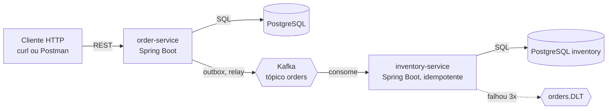
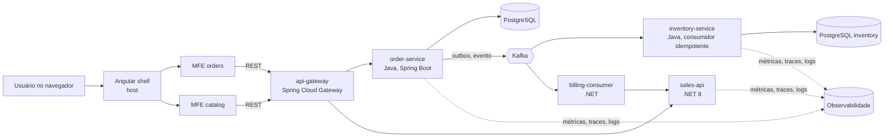
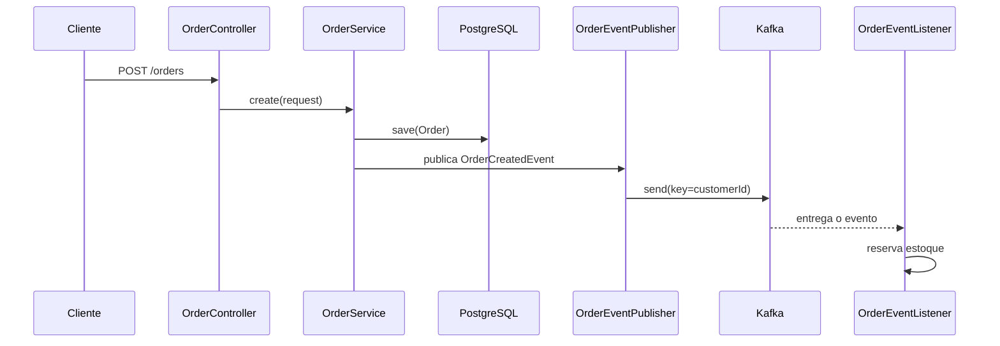
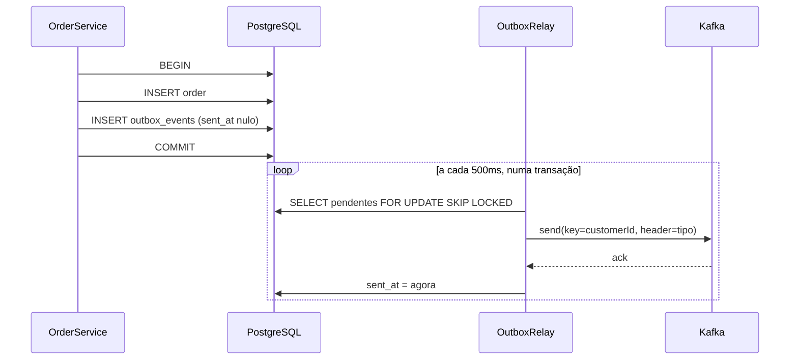
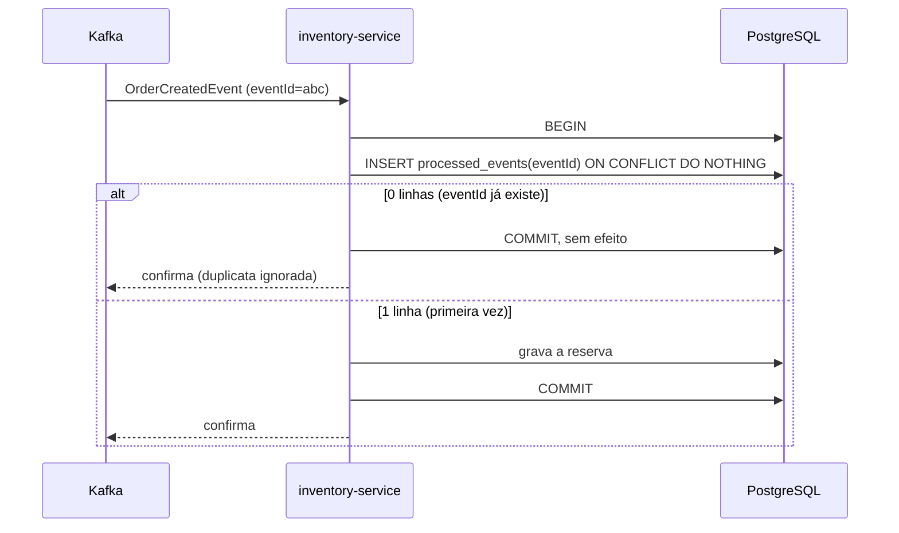
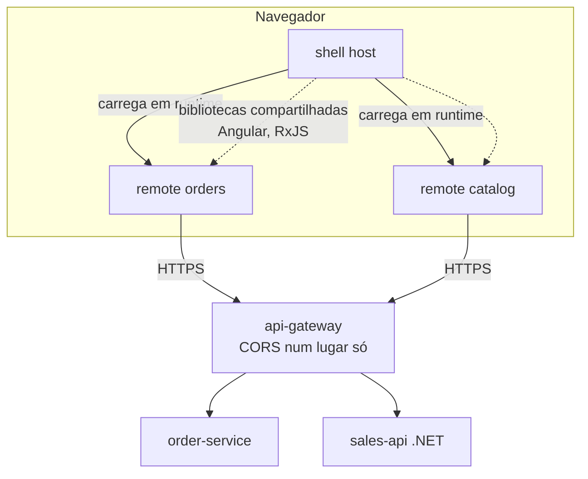

# Arquitetura: de onde estamos para onde vamos

Documento de trabalho da evolução do projeto: do par `order-service` e `inventory-service` para uma plataforma de vendas ponta a ponta, com front-end em micro front-ends Angular, mensageria, serviço .NET, observabilidade e deploy em plano gratuito. Os diagramas são Mermaid (o GitHub os renderiza).

## 1. Visão macro (contexto)

### Hoje

O fluxo de hoje, em uma frase: um pedido entra por REST e é gravado no PostgreSQL junto com o seu evento (outbox), que um relay publica no Kafka; o `inventory-service` reserva ou libera o estoque no seu próprio banco, ignora evento duplicado e manda para o DLT o que falha.

### Alvo

## 2. Visão média (contêineres)

### Hoje (o que existe no repositório)

| Contêiner | Tecnologia | Papel |
|---|---|---|
| `web-shell` | Angular 22.2, Native Federation | Host: layout, roteamento e carregamento do remote em runtime pelo manifesto (ADR 10) |
| `web-orders` | Angular 22.2, Native Federation | Remote: expõe as rotas de pedidos (listar, criar, cancelar) e chama o gateway |
| `api-gateway` | Java 17, Spring Boot 4, Spring Cloud Gateway (WebFlux) | Entrada única do front: `/api/orders/**` para o `order-service`, CORS e `X-Correlation-Id` (ADR 9) |
| `order-service` | Java 17, Spring Boot 4, Web, Data JPA, Spring Kafka | API REST de pedidos (criar, atualizar, listar paginado, cancelar); eventos gravados no outbox na mesma transação e publicados pelo `OutboxRelay` |
| `inventory-service` | Java 17, Spring Boot 4, Data JPA, Spring Kafka | Consome `orders`: reserva no `created`, libera no `cancelled`; idempotente por `eventId` (`processed_events`); 3 tentativas e depois `orders.DLT` |
| PostgreSQL inventory | 1 instância | Dados do `inventory-service` (`reservations`, `processed_events`) |
| PostgreSQL | 1 instância | Dados do `order-service` (`orders`, `outbox_events`) |
| Kafka | KRaft, 1 broker, tópicos `orders` e `orders.DLT` com 3 partições | Eventos `created`, `updated`, `cancelled`, chave = `customerId` |

Decisões já registradas: [docs/adr](adr/) (tópico com dono, valor monetário com duas casas, concorrência otimista, paginação, tipo do evento no header, ciclo de vida do pedido, consumidor idempotente e DLT, outbox, API gateway, micro front-ends, contrato monetário em centavos).

### Alvo (proposta)

| Contêiner | Tecnologia | Papel novo |
|---|---|---|
| `web-shell` e `web-orders` | Angular | Já existem (fase 3) |
| `web-catalog` | Angular | Remote: produtos, consome a `sales-api` (.NET) |
| `api-gateway` | Spring Cloud Gateway | Já existe (fase 3); ganha a rota da `sales-api` na fase 5 |
| `order-service` | Java, Spring Boot | Já com outbox (fase 2); segue como está |
| `inventory-service` | Java, Spring Boot | Já existe (fase 1); segue como está |
| `billing-consumer` | .NET 8 | Consome `orders` e registra a venda na `sales-api` |
| `sales-api` | .NET 8 (projeto existente) | API de vendas, já com DDD, CQRS, PostgreSQL, MongoDB e Redis |
| Observabilidade | OpenTelemetry, Micrometer | Métricas, traces e logs com id de correlação |

## 3. Visão micro (dentro de cada peça)

### 3.1 Antes do outbox (até a fase 1): criação de um pedido

A lacuna que motivou a fase 2: gravar no banco e publicar no Kafka eram dois passos separados. Se o processo caísse entre eles, o pedido existia e o evento se perdia (ou o contrário).

### 3.2 Hoje: outbox no `order-service` (fase 2, feita)

Garantia: o evento é entregue pelo menos uma vez. Pode haver duplicata (se o relay cair depois do envio e antes de marcar), e o consumidor idempotente a descarta pelo `eventId`, que é o id da linha do outbox. Detalhes e alternativas: [ADR 8](adr/0008-outbox-no-order-service.md).

### 3.3 Hoje: consumidor idempotente (fase 1, feita)

Falha no processamento tem 3 tentativas com 1s de intervalo e depois vai para o `orders.DLT`, com o motivo nos headers; erro de desserialização vai direto. A chave primária de `processed_events` garante que a mesma mensagem não produz efeito duas vezes. Detalhes e alternativas: [ADR 7](adr/0007-consumidor-idempotente-e-dlt.md).

### 3.4 Hoje: micro front-ends (fase 3; o remote catalog vem na fase 5)

Pontos de atenção: o que é compartilhado e versionado (Angular, RxJS), como os remotes são carregados em runtime, deploy independente de cada remote, e os riscos (versões divergentes, estilo global, comunicação entre remotes, duplicação de código).

## 4. Observabilidade (alvo)

- Métricas: Spring Boot Actuator e Micrometer (tempo por endpoint, pool de conexões, lag do consumidor).
- Traces: OpenTelemetry com propagação do id de correlação do front, passando pelo `order-service`, pelo Kafka (headers) até o consumidor.
- Logs estruturados com o id de correlação.
- Pergunta que isso responde: a requisição está lenta no back-end ou no banco? Roteiro: olhar o trace (onde está o tempo), depois o `EXPLAIN` da consulta e o uso do pool.

## 5. Deploy em plano gratuito (a pesquisar)

Candidatos a verificar nas páginas oficiais antes de decidir (planos e limites mudam): Azure Container Apps, Oracle Cloud always free, Fly.io, Render, Railway, Grafana Cloud para observabilidade, Redpanda ou Upstash para Kafka gerenciado.
Critérios: custo zero comprovado, limite de memória e tempo ocioso, e se roda 2 serviços Java e Kafka.

## 6. Decisões em aberto

| Decisão | Opções | Situação |
|---|---|---|
| Versão do Angular | v22 (mais recente), v21 (LTS), v20 (LTS até 28/11/2026) | Decidido: 22.2.6 fixado, a mais nova suportada pela Native Federation 22.2.5 (ADR 10), 25/11/2026 |
| Dinheiro no contrato | decimal no JSON, decimal como string, centavos inteiros; centavos em todo lugar | Decidido: contrato (API e eventos) em centavos, domínio e banco em decimal exato (ADR 11), 25/11/2026 |
| Papel do consumidor | estoque, faturamento, notificação | Decidido: estoque (`inventory-service`), 19/11/2026 |
| Faturamento em .NET | consumir `orders` e chamar a `sales-api` | Fase seguinte |
| Spring Cloud no projeto | Gateway; Gateway com Eureka e Config Server; Spring Cloud Stream | Decidido: só o Gateway, na fase 3 (25/11/2026). No Compose, o DNS da rede já resolve o endereço dos serviços, então Eureka seria peça sem função; Config Server, idem, com um `application.properties` por serviço |
| Kafka em produção gratuita | gerenciado (limites) ou subir junto no contêiner | A pesquisar |

## 7. Angular: qual versão

Dados da [página oficial de versões](https://angular.dev/reference/releases):

| Versão | Situação (consultada em 18/11/2026) |
|---|---|
| v22 | Mais recente, lançada em 03/06/2026, suporte ativo até 06/2027 |
| v21 | LTS, correções críticas até 06/2027 |
| v20 | LTS termina em 28/11/2026 |

Recomendação: começar na v22 (ou v21, se a biblioteca de federação escolhida ainda não suportar a v22; conferir na instalação). Empresa grande costuma ficar algumas versões atrás da mais nova, mas isso é leitura minha, não dado medido. Saber explicar também o modelo antigo (módulos, Webpack Module Federation) e o novo (standalone, Native Federation) cobre os dois cenários.

## 8. Plano de execução

1. Fase 1: `inventory-service` idempotente, retry e Dead Letter Topic, com teste de integração. Feita em 19/11/2026.
2. Fase 2: outbox no `order-service`. Feita em 25/11/2026.
3. Fase 3: `api-gateway` (Spring Cloud Gateway), shell e remote Angular rodando com o `order-service` através dele. Feita em 25/11/2026.
4. Fase 4: observabilidade (métricas e traces).
5. Fase 5: `billing-consumer` .NET e remote catalog.
6. Fase 6: deploy em plano gratuito.

## 9. Critérios de pronto e fora do escopo

Pronto quando:

- [ ] `docker compose up` sobe tudo (Kafka, bancos, serviços, gateway) e o front roda.
- [x] Teste de integração da idempotência passando.
- [ ] README com diagrama, como rodar, decisões e aprendizados.
- [ ] Repositório público sem segredo no código (gitleaks no pre-commit) e revisado contra a lista de vulnerabilidades.

Fora do escopo por enquanto: Kubernetes, autenticação completa e UI caprichada.
